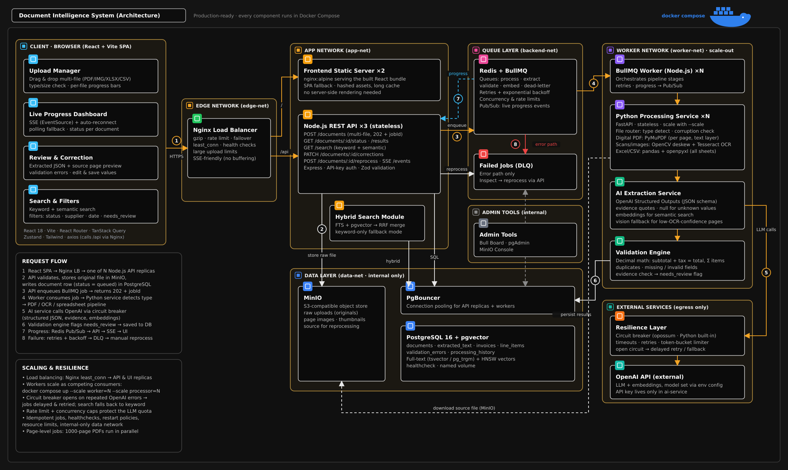

# AI-Powered Document Intelligence System

A production-ready, distributed, and scalable AI-Powered Document Intelligence System engineered to ingest, parse, validate, extract structured invoice information, and provide hybrid semantic search across financial business documents (PDF, JPG, PNG, TIFF, XLSX, XLS, and CSV).

---

## 🏛 System Architecture

Every component runs containerized and orchestrated via **Docker Compose** across isolated Docker bridge networks:

- **Edge Network (`edge-net`):** Nginx Load Balancer operating with the **`least_conn`** algorithm, buffering disabled for SSE streaming, and 100MB body upload capacity.
- **App Network (`app-net`):** Express REST API replicas (`Node.js REST API x3`) with HTTP-only cookie JWT authentication, Multi-Tenant Client isolation, dynamic API-Key verification, and Zod validation.
- **Queue Layer (`backend-net`):** Redis 7 + BullMQ managing decoupled pipeline queues (`process`, `extract`, `validate`, `embed`, `dead-letter`).
- **Worker Network (`worker-net`):** Node.js BullMQ Pipeline Workers coordinating with a stateless **Python Processing Microservice** (PyMuPDF, OpenCV deskew, PaddleOCR, and pandas/openpyxl).
- **Data Layer (`data-net`):** PostgreSQL 16 + `pgvector` (GIN Full-Text Search and HNSW cosine vector indexes) paired with **MinIO** S3-compatible object storage.
- **Resilience Layer:** Opossum Circuit Breakers, exponential backoff retries, and high-precision financial Decimal math (`decimal.js`).

---

